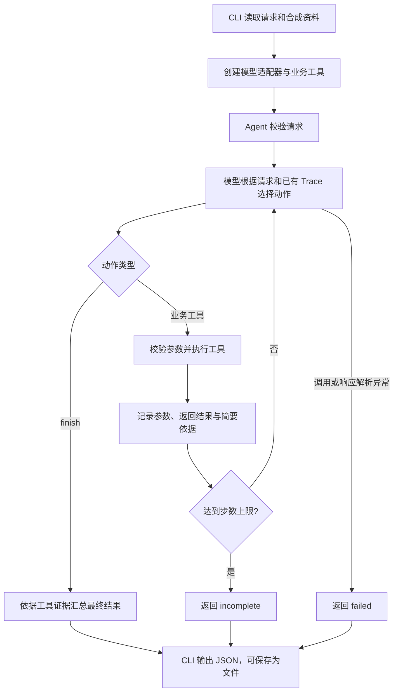

# 素材审核与发布排期 Agent

题号：1。帮助内容团队审核合成素材、处理排期冲突，并保存可确认的排期草稿。**不接入真实发布**。

## 当前验证状态

离线验收 8/8、真实 DeepSeek 验收 8/8、自动化测试 19/19 通过。真实模型为 deepseek-flash，记录见 `examples/real/report.json`。保留首次参数错误记录与改进过程；一次验收通过不代表所有输入均可靠。Mock 仅验证流程，不作为真实模型决策效果证据。

## 环境和快速运行

Python 3.7+，仅标准库；本机验证版本 Python 3.7.4。无需 pip 依赖、MySQL 或独立 SQLite 服务。建议新环境使用 Python 3.11+。全部命令从仓库根目录执行。

```powershell
python -m src.evaluate --mode mock
python -m unittest discover -s tests -v
python -m src.cli --input examples/inputs/conflict.json --mode mock --output examples/manual-conflict.json
```

最后一条应返回 needs_confirmation，建议 19:00，未保存、未发布。CLI 每次接受一个素材请求；多个素材分别执行，以避免部分成功状态含糊。

## 使用真实 DeepSeek

复制 `.env.example` 为 `.env`（已有文件请勿覆盖），在本机编辑填入密钥。`.env` 已被 Git 忽略。

```text
DEEPSEEK_API_KEY=填写自己的密钥
DEEPSEEK_BASE_URL=https://api.deepseek.com
DEEPSEEK_MODEL=deepseek-flash
```

```powershell
python -m src.cli --input examples/inputs/conflict.json --mode real --output examples/real/smoke-conflict.json
python -m src.evaluate --mode real
```

真实验收会调用付费 API，多步执行；每个模型请求超时 45 秒，每次任务最多 10 步，不自动重试。模型名可通过环境变量修改。模型不可用时明确失败，不偷偷切换 Mock。正式提交前检查 `examples/real/report.json` 和各 Trace，更新评估文档。

## 用户确认与重复提交

请求字段：`request_id`（幂等键）、`material_id`、`requested_slot`；可选 `confirmed_slot` 是用户明确批准的新时间，不能由模型生成授权。演示日期均采用北京时间、精确到分钟，输入格式 `YYYY-MM-DDTHH:MM`。

发生冲突后，由用户确认，将同一请求加入 `confirmed_slot` 再执行。查看 `examples/inputs/confirmed.json`。相同请求和同一时段重复保存返回同一个草稿；已保存请求改变内容会返回 `idempotency_conflict`，新任务应使用新 ID。

```powershell
python -m src.cli --input examples/inputs/confirmed.json --mode mock
python -m src.cli --input examples/inputs/confirmed.json --mode mock
python -m src.cli --input examples/inputs/save_failure.json --mode mock --fail-save --db failure-demo.db
```

本地草稿默认存在 `drafts.db`，不进 Git。该演示将草稿占用时段视为排期占用。评估器使用隔离临时库，不受手动运行残留数据影响。CLI 的 failed/incomplete 返回退出码 1，业务成功或等待用户输入返回 0。

## 代码架构

项目使用原生 Python 实现，通过命令行入口组装模型适配器、Agent 循环和业务工具。没有引入 Agent 框架；真实模式与离线模式复用同一个执行循环和同一组业务工具，仅替换动作选择器。

### 目录与模块职责

```text
agent-exam/
├── src/
│   ├── cli.py                 # 命令行入口、配置读取与结果输出
│   ├── agent.py               # 请求校验、有界决策循环、Trace 和状态汇总
│   ├── models.py              # DeepSeek 接口、提示词、离线 Mock
│   ├── tools.py               # 四个业务工具及 SQLite 草稿存储
│   └── evaluate.py            # 八类场景的运行、结果核对与记录生成
├── data/catalog.json          # 合成素材、审核规则、候选时段与已有占用
├── tests/
│   ├── test_agent.py          # 业务流程、授权边界、防重复与异常测试
│   └── test_model_adapter.py  # API 请求构造和响应解析测试
├── examples/
│   ├── inputs/                # 可直接运行的请求 JSON
│   ├── real/                  # 真实模型输入、输出、Trace 与验收汇总
│   └── mock/                  # 离线运行记录、汇总与自动化测试结果
├── docs/                      # 需求、方案、评估、AI 使用与复盘
├── .env.example               # 配置模板，实际密钥只存本地 .env
└── requirements.txt           # 说明仅依赖 Python 标准库
```

| 模块 | 主要接口 | 职责 |
| --- | --- | --- |
| `cli.py` | `main()` | 解析输入文件、运行模式、数据库路径和步数限制；创建模型与工具，调用 Agent 并输出 JSON |
| `agent.py` | `validate_request()`、`run_agent()` | 校验请求；反复执行模型决策与工具调用；记录步骤；根据实际工具结果汇总最终状态 |
| `models.py` | `DeepSeekModel.decide()`、`MockModel.decide()` | 接收请求与已观察到的 Trace，返回 `action`、`arguments`、`reason`；真实模式调用 DeepSeek，Mock 模式使用脚本分支 |
| `tools.py` | `BusinessTools.execute()` | 校验工具名与参数，将动作分派至素材读取、规则检查、时段查询或草稿保存 |
| `evaluate.py` | `main()` | 为各场景创建隔离临时数据库，注入指定条件，核对状态及草稿数量，并保存实际记录 |

### 一次任务如何运行



正常路径通常为 `read_material → check_rules → query_slots → save_draft → finish`。这条路径由提示词引导、由模型逐步选择，并非运行时写死的顺序脚本。例如查询发现原时段被占用后，模型可以结束并请求用户确认替代时段；保存工具返回错误后，模型可以报告失败。

每一步的 `step`、`action`、`arguments`、`reason` 和工具 `result` 保存在结果 JSON 的 `trace` 数组中。下一项体现后续动作；`finish` 不调用业务工具，因此没有工具返回值。评估器另外记录所用资料、故障开关和数据库草稿数，便于复核测试条件。

### 模型决策与业务约束的分工

模型负责选择下一步动作；业务工具负责执行和约束。`BusinessTools` 创建时绑定用户请求，模型不能通过工具参数替换素材身份或伪造用户确认。前三个工具参数必须为 `{}`，保存工具只接受 `{"slot":"..."}`。

保存前，Agent 要求已调用读取、规则检查和时段查询工具；保存工具还会重新检查审核状态、时段授权与占用。改变硬性时间必须得到输入中的 `confirmed_slot` 授权。最终 `saved` 状态依据实际保存结果，不能仅凭模型声称成功；系统没有发布工具，输出始终标明 `published=false`。

草稿存储封装在 `tools.py` 中，使用 SQLite 事务和唯一约束：`request_id` 防止相同请求重复生成草稿，`slot` 防止两个请求占用同一时间槽；请求指纹用于拒绝同一 ID 下的内容变更。数据库操作失败时回滚并返回失败结果。

### 验证入口与扩展位置

`evaluate.py` 直接调用与 CLI 相同的 `run_agent()`，真实和离线验收只切换模型适配器。重复场景在同一数据库运行两次，其余场景使用独立数据库。`tests/` 另外检查越权保存、虚报成功、步数耗尽和接口解析等边界。

更换模型服务时实现相同的 `decide(request, trace)` 接口，并提供 `mode`、`model` 标识；更换存储实现时修改业务工具内部的保存与占用查询逻辑。新增业务工具需同时更新参数校验、模型提示词和相关测试。更完整的设计取舍见 [方案文档](docs/02-solution.md)。

## 评审入口

- `src/agent.py`：有界模型决策循环及基于工具证据的结果汇总。
- `src/models.py`：真实 JSON 动作选择；单独标注的离线替身。
- `src/tools.py`：素材读取、规则检查、时段查询、事务性草稿保存。
- `tests/`：验收和越权/虚报/幂等边界测试。
- `examples/mock/report.json`、`examples/mock/tests.txt`：实际离线验证结果；逐用例 JSON 含输入、输出、Trace 和故障注入条件。
- `docs/01-requirements.md` 至 `docs/05-retrospective.md`：需求、设计、评估、AI 使用和复盘。
